# 🫀 ECG Arrhythmia Classification on Unseen Patients
### Random Forest vs lightweight 1D CNN, evaluated the honest way (patient-disjoint)

   -red)

> **Research question:** How well can a lightweight 1D CNN classify normal vs abnormal heartbeats from **patients it has never seen**, compared with a traditional machine learning baseline?

> ⚠️ This is a **beat-level** machine learning study on a public research database. It is **not** a medical device and does **not** make clinical diagnoses.

---

## 📌 TL;DR

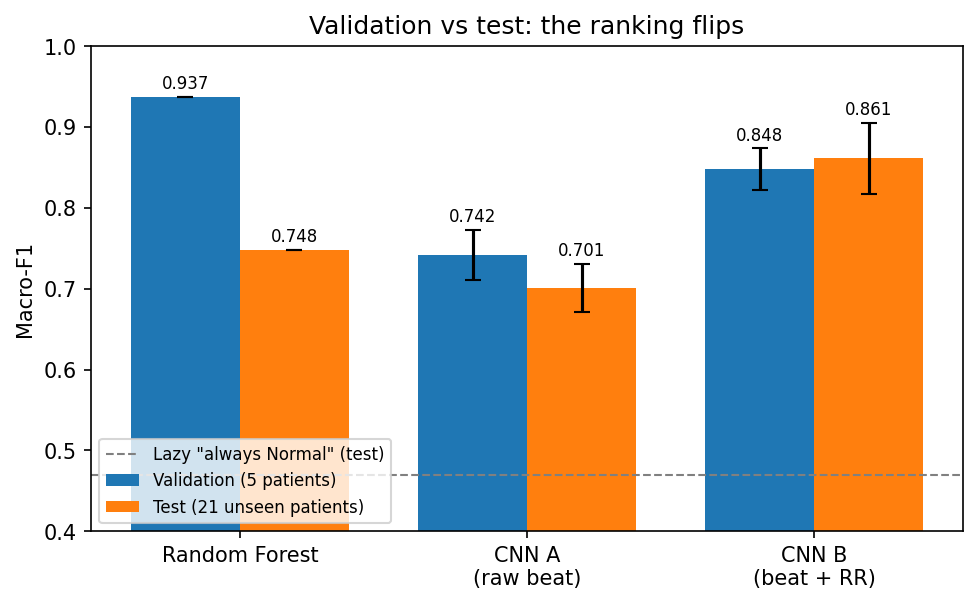

| Model | Validation macro-F1 (5 patients) | **Test macro-F1 (21 unseen patients)** |
|---|---|---|
| Lazy baseline (always "Normal") | 0.488 | 0.470 |
| Random Forest (17 handcrafted features) | **0.937** | 0.748 |
| 1D CNN A (raw beat only, 3 seeds) | 0.742 ± 0.031 | 0.701 ± 0.030 |
| **1D CNN B (raw beat + RR timing, 3 seeds)** | 0.848 ± 0.026 | **0.861 ± 0.044** |

**Key takeaways**
- 🔄 **The ranking flipped.** The Random Forest looked best on validation, but on 21 unseen test patients the CNN with timing features was clearly ahead (precision 0.79 vs 0.47).
- 📊 **How sure?** A patient-level bootstrap gives RF − CNN B = **−0.204 to +0.029** (95% CI). The RF wins in only **5.4%** of resamples → CNN B is *probably* better; the evidence is suggestive, not conclusive (21 patients).
- 🔍 **Why the RF failed:** **distribution shift.** One test patient's heart was faster than any training patient (trees can't extrapolate), and another patient's "normal rhythm" was mostly abnormal beats.
- ✅ **Learned shape beats handcrafted shape:** CNN A (raw beat) 0.742 vs RF shape-only 0.534 on validation.
- 💓 **V beats are essentially solved** by both models (recall ~0.98). **S beats remain the hard part.**

---

## 📚 Table of contents
1. [Background in 60 seconds](#-background-in-60-seconds)
2. [Why this is harder than it looks](#-why-this-is-harder-than-it-looks)
3. [Dataset and labels](#-dataset-and-labels)
4. [Evaluation protocol](#-evaluation-protocol-no-patient-leakage)
5. [Pipeline](#-pipeline)
6. [Models](#-models)
7. [Results](#-results)
8. [Error analysis: why models fail](#-error-analysis-why-models-fail)
9. [Limitations](#-limitations)
10. [Future work](#-future-work)
11. [Reproduce](#-reproduce)
12. [Repository structure](#-repository-structure)
13. [References](#-references)

---

## 🫀 Background in 60 seconds

An **ECG** records the heart's electrical activity. Each beat has three parts:

```
        R
        |
   P    |      T          P   = atria contract   ("prepare")
  /\    |     /\          QRS = ventricles contract ("squeeze", the tall spike)
_/  \__/ \___/  \___      T   = recovery          ("rest")
       Q  S
```

An **arrhythmia** is a beat with the wrong **timing** or the wrong **shape**:

| AAMI class | What it is | What gives it away |
|---|---|---|
| **N**: Normal | Normal beats (incl. bundle branch block) | n/a |
| **S**: Supraventricular ectopic | Starts above the ventricles | ⏱️ **Timing**: comes too early, shape looks normal |
| **V**: Ventricular ectopic | Starts in the ventricles | 📐 **Shape**: wide, strange QRS |
| **F**: Fusion | Mix of a normal and a V beat | In between |

**Task:** given one heartbeat, predict **Normal (0)** or **Abnormal (1 = S, V or F)**. Subtypes are tracked so recall can be reported for S, V and F separately.

<p align="center">
  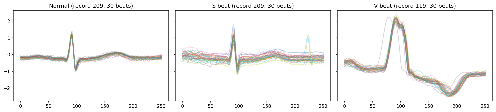<br>
  <em>N and S beats look almost identical; V beats look completely different.</em>
</p>

<p align="center">
  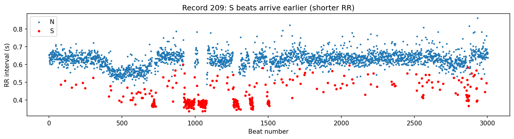<br>
  <em>But S beats arrive ~33% earlier (record 209: mean RR 0.42 s vs 0.63 s).</em>
</p>

---

## ⚠️ Why this is harder than it looks

1. **Patient leakage.** Everyone's "normal" beat looks a bit different. If beats from the same person appear in both training and test, the model can recognise the *person*, not the arrhythmia. Random beat-level splits are why many papers report ~99% accuracy. This project uses a **strict patient-disjoint split**.
2. **Class imbalance.** ~90% of beats are normal. A model that always says "Normal" scores **95.5% accuracy** on our validation set while catching **zero** abnormal beats. So we report **macro-F1**, precision, recall and per-subtype recall, never accuracy alone.
3. **Few patients.** Errors come in *patient-sized chunks*: a model "gets" or "doesn't get" a whole patient. The real sample size is the number of patients, not beats.

---

## 🗂️ Dataset and labels

- **MIT-BIH Arrhythmia Database** (PhysioNet): 48 half-hour two-lead recordings from 47 people, 360 Hz, every beat annotated by cardiologists.
- **Lead:** MLII, selected **by name** (record 114 stores its leads in swapped order).
- **Excluded:** paced records 102, 104, 107, 217 · Q (unclassifiable/paced) beats.
- **Label mapping (AAMI EC57):**

| AAMI class | MIT-BIH symbols | Binary label |
|---|---|---|
| N | N, L, R, e, j | 0 |
| S | A, a, J, S | 1 |
| V | V, E | 1 |
| F | F | 1 |
| Q | /, f, Q | excluded |

**Sanity check:** our DS1 counts (45,866 N / 944 S / 3,788 V / 415 F) match de Chazal et al. (2004) exactly.

---

## 🔒 Evaluation protocol (no patient leakage)

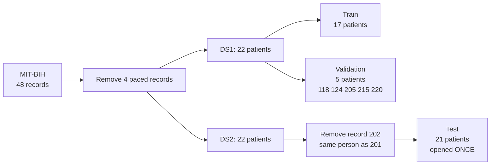

- Split follows the **de Chazal et al. (2004) inter-patient protocol**.
- **Record 202 removed from test:** it comes from the same person as record 201 (in training).
- Validation patients were chosen to contain both S and V beats.
- **All choices** (features, hyperparameters, epochs) were made on validation. The test set was opened once, after every model was frozen, with predictions written down beforehand.
- Anything "learned" from data (RR scaling, class weights) uses **training data only**.

| Set | Patients | Beats | N | S | V | F | Abnormal % |
|---|---|---|---|---|---|---|---|
| Train | 17 | 39,015 | 34,412 | 716 | 3,490 | 397 | 11.8 |
| Validation | 5 | 11,954 | 11,412 | 227 | 298 | 17 | 4.5 |
| Test | 21 | 47,527 | 42,159 | 1,781 | 3,200 | 387 | 11.3 |

<p align="center">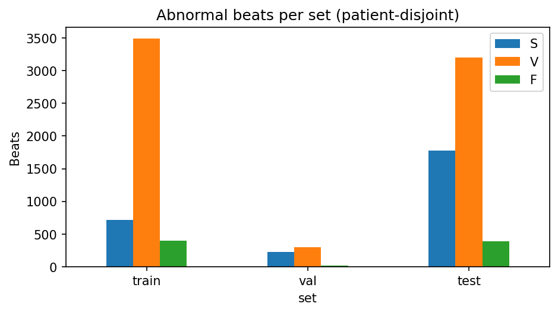</p>

---

## ⚙️ Pipeline

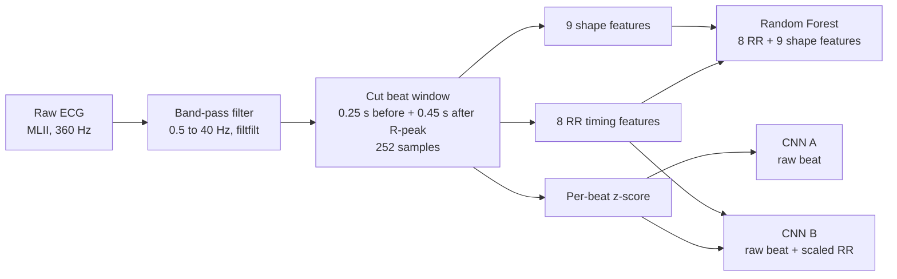

**Preprocessing details**
- **Band-pass filter** (3rd-order Butterworth, 0.5 to 40 Hz) removes baseline wander and high-frequency noise. `filtfilt` runs forward and backward, so R-peaks don't shift.
- **Per-beat z-score**: each beat is normalised with its own mean and std → no statistics shared across beats, patients or sets.
- **RR timing features** (all backward-looking except `post_rr`):

| Feature | Meaning |
|---|---|
| `pre_rr`, `post_rr` | Time since the previous beat / until the next beat |
| `local_rr` | Mean of the last 10 RR intervals |
| `long_rr` | **Median** of the last 300 RR intervals (~5 min) |
| `rel_*_local`, `rel_*_long` | `pre_rr` and `post_rr` divided by `local_rr` / `long_rr` |

> 🔍 **An assumption corrected with data:** we first used only the 10-beat average. In record 209, S beats come in runs, so that average itself became fast and S beats barely looked early (ratio 0.895). A long-term **median** fixed it (ratio **0.644**).

<p align="center">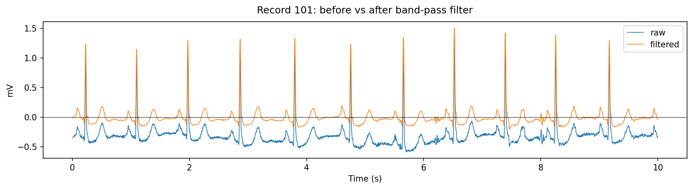</p>

---

## 🧠 Models

### Random Forest (baseline)
- **17 features:** 8 RR timing + 9 handcrafted shape features (R height, Q and S dips, QRS width at half height, QRS area, T-wave max/min, beat std, peak-to-peak).
- 300 trees, `class_weight='balanced'` (Normal 0.567, Abnormal 4.238).
- Grid: `max_depth` ∈ {None, 20, 10} × `min_samples_leaf` ∈ {1, 5, 20}, selected by **validation macro-F1** → best: `max_depth=10`, `min_samples_leaf=5`.

### 1D CNN (11,297 parameters)

```
Beat (252×1)
 → Conv1D 16 filters, k=7, ReLU → MaxPool(2)
 → Conv1D 32 filters, k=5, ReLU → MaxPool(2)
 → Conv1D 64 filters, k=3, ReLU → GlobalAveragePooling
 → [CNN B only: concatenate 8 standardised RR features]
 → Dropout 0.3 → Dense 32, ReLU → Dense 1, sigmoid
```
- **Why two versions?** The RF ablation showed timing is the strongest signal. A raw-beat-only CNN vs the full RF would be unfair, so:
  - **CNN A vs RF shape-only** → are *learned* shape features better than *handcrafted* ones?
  - **CNN B vs RF full** → main comparison, same information for both.
- Adam (lr 0.001), binary cross-entropy, batch 256, class weights, up to 40 epochs.
- A custom callback computes **validation macro-F1 after every epoch**, keeps the best epoch, and stops after 8 epochs without improvement.
- **3 seeds** (42, 1, 2) per version; results reported as mean ± std.
- Trained in 18 to 44 s per run on a Colab T4 GPU.

---

## 📈 Results

### 1. Validation: what timing and shape each contribute (RF ablation)

| Features | Macro-F1 | Abn. precision | Abn. recall | S recall | V recall |
|---|---|---|---|---|---|
| Lazy baseline | 0.488 | n/a | 0 | 0 | 0 |
| RF shape only | 0.534 | 0.11 | 0.45 | 0.12 | 0.72 |
| RF RR only | 0.900 | 0.90 | 0.74 | **0.83** | 0.71 |
| **RF RR + shape** | **0.937** | **0.99** | 0.79 | 0.79 | **0.83** |
| CNN A (raw beat) | 0.742 ± 0.031 | 0.85 | 0.36 | 0.09 | 0.58 |
| CNN B (beat + RR) | 0.848 ± 0.026 | 0.81 | 0.65 | 0.44 ± 0.31 | 0.84 |

- **S beats need timing:** shape-only catches 12% of S beats, RR-only catches 83%.
- **Handcrafted shape features transfer poorly to new patients** (precision 0.11). **Learned shape features transfer much better** (CNN A precision 0.85).

<p align="center">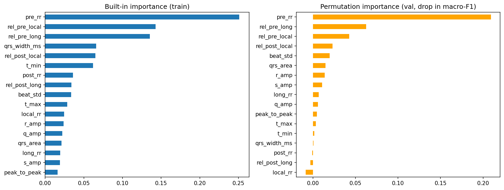</p>

### 2. Test: 21 unseen patients (opened once)

| Model | Macro-F1 | Abn. precision | Abn. recall | S recall | V recall | F recall |
|---|---|---|---|---|---|---|
| Lazy baseline | 0.470 | 0 | 0 | 0 | 0 | 0 |
| CNN A (3 seeds) | 0.701 ± 0.030 | 0.43 | 0.56 | 0.07 | 0.89 | 0.14 |
| Random Forest | 0.748 | 0.47 | 0.72 | 0.20 | **0.98** | 0.94* |
| **CNN B (3 seeds)** | **0.861 ± 0.044** | **0.79** | **0.74** | **0.43** | **0.98** | 0.17 |

\* *Not meaningful: the RF flagged ~96% of patient 213's normal beats as abnormal, so it also "caught" that patient's F beats.*

CNN B per seed: 0.898 · 0.813 · 0.872.

<p align="center">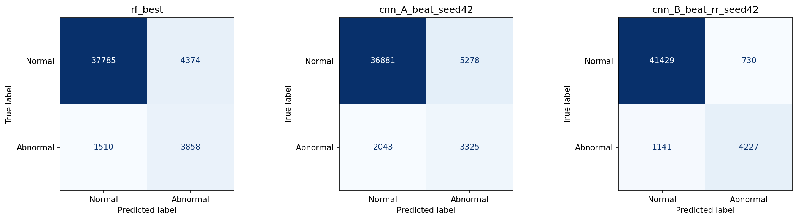</p>

### 3. How confident is "CNN B > RF"? (patient bootstrap)
1,000 resamples of the 21 test **patients** (not beats):

| | 95% CI |
|---|---|
| RF macro-F1 | 0.634 to 0.914 |
| CNN B macro-F1 | 0.782 to 0.927 |
| **RF − CNN B** | **−0.204 to +0.029** |

The RF wins in only **5.4%** of resamples.

### 4. Per patient

<p align="center">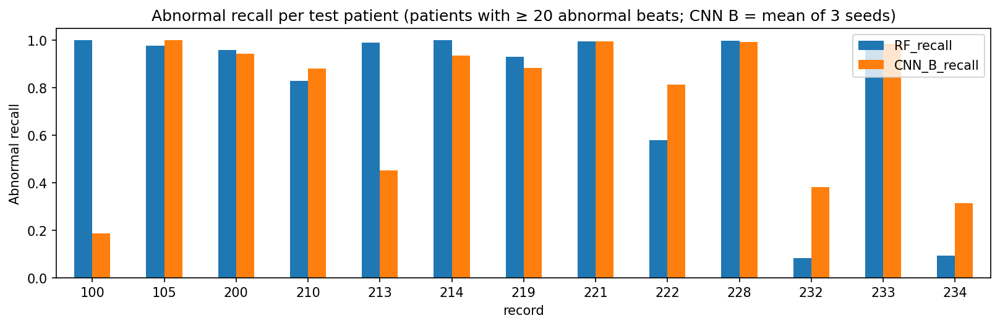</p>

---

## 🔬 Error analysis: why models fail

### Validation (CNN)
- ❌ **Hypothesis rejected:** we expected the CNN to confuse right bundle branch block beats (labelled Normal, wide QRS) with V beats, since validation has 3,693 of them and training only 85. In fact only 3 to 9 were misclassified.
- **False alarms came almost entirely from one patient (215):** normal beats where the **next beat already enters the window** at a fast heart rate → likely **shortcut learning** ("bump at the end of the window = abnormal"). Not proven.

<p align="center">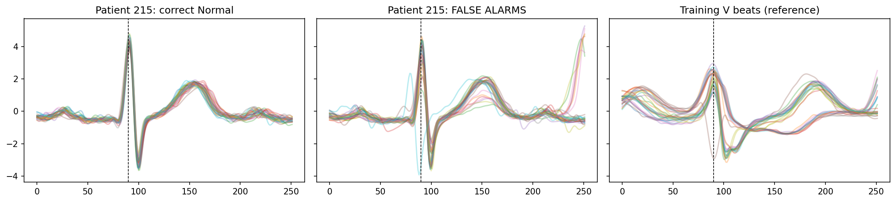</p>

### Test (Random Forest collapse)
Post-hoc analysis, **no model was changed or re-selected afterwards**:

1. ✅ **Heart-rate extrapolation.** Training patients' median RR: 0.578 to 1.028 s. Patient **213** (0.556 s) is faster than all of them → RF false alarms on **96.5%** of its normal beats (CNN B: 0.2%). Patient 233 (0.589 s, at the edge) → 53.6% (CNN B: 5.7%). Trees can't extrapolate, and the RF's top feature, absolute `pre_rr`, effectively encodes heart rate.
2. ✅ **"Normal is the majority" assumption broken.** In patient **232**, 78% of beats are S. The long-term median RR is set by S beats, so S beats look on time (ratio 0.992) while normal beats follow long pauses. RF caught 8% of its S beats, CNN B 38%.
3. ❌ **Irregular rhythm alone:** not supported (patient 231 is more irregular than 219 but has 0.1% false alarms).

<p align="center">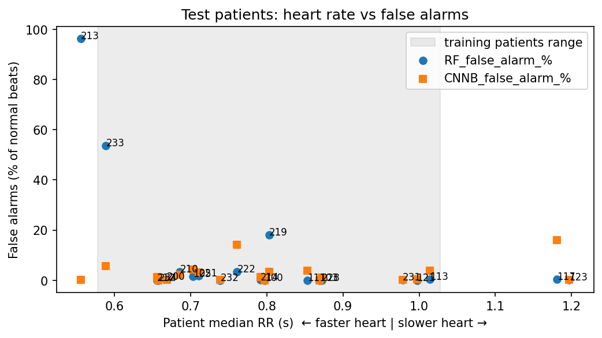</p>

### Lessons
- 🧩 **Errors are patient-clustered**, so per-patient reporting matters as much as one overall number.
- 🔄 **A 5-patient validation set was not representative** and would have picked the wrong model.
- 🌍 **Distribution shift** (heart rate, rhythm type) broke the handcrafted model's assumptions more than the CNN's.

---

## 🚧 Limitations
- Only **47 patients**, recorded in the late 1970s at one hospital → limited diversity.
- Beats are cut at **cardiologist-annotated** R-peaks, not automatically detected (common, but optimistic).
- One lead (MLII); `post_rr` uses the next beat → offline classification.
- **Validation set of only 5 patients** (17 F beats) → noisy model selection.
- **F class** is dominated by one training patient (208) → not learned in a transferable way.
- CNN results vary between seeds (test macro-F1 0.813 to 0.898); only 3 seeds.
- Small hyperparameter grid; default 0.5 threshold; no CNN architecture search; small receptive field (~72 ms).
- Fixed 0.7 s window can include the next beat at fast heart rates.
- Test conclusions rest on **21 patients**; the bootstrap interval for RF − CNN B just touches 0.

## 🔭 Future work
- **Patient-level cross-validation** across all 22 DS1 patients instead of a single 5-patient validation set.
- Remove **absolute** RR features (keep relative ones) and evaluate on an **independent dataset** (e.g. INCART). The MIT-BIH test set has now been seen, so it can't fairly judge changes inspired by it.
- **RR-adaptive or shorter windows** to remove the "next beat in the window" shortcut.
- Larger receptive field (bigger kernels, dilated convolutions) or multi-beat rhythm context.
- More seeds, decision-threshold analysis, and saliency maps (e.g. Grad-CAM) to see what the CNN looks at.

---

## ▶️ Reproduce

Runs in **Google Colab** with Google Drive. Notebooks are numbered in order:

| # | Notebook | Runtime | What it does |
|---|---|---|---|
| 00 | `00_setup.ipynb` | CPU | Folders, downloads MIT-BIH, writes `src/config.py` |
| 01 | `01_data_exploration.ipynb` | CPU | Structure, beat shapes, RR timing, class counts, split |
| 02 | `02_preprocessing.ipynb` | CPU | Filter, beat windows, RR features, z-score, saves `.npz` |
| 03 | `03_baseline_random_forest.ipynb` | CPU | Features, grid search, importance, ablation |
| 04 | `04_cnn_training.ipynb` | **T4 GPU** | CNN A and B, 3 seeds, learning curves, error analysis |
| 05 | `05_evaluation.ipynb` | CPU | Test evaluation, bootstrap, per-patient, post-hoc diagnostics |

1. Copy this repository into `MyDrive/ECG_Arrhythmia_Classification` (or change `PROJECT` in `src/config.py`).
2. Run the notebooks in order. `00_setup` downloads the data from PhysioNet (`data/` is not included in this repo).
3. Package versions: `requirements.txt`. Random seed: 42 (CNN seeds 42, 1, 2).

All settings (paths, split, labels, window, seed) live in **`src/config.py`**. Shared code: `src/eval_utils.py` (metrics) and `src/features.py` (RF features).

---

## 📁 Repository structure

```
ECG_Arrhythmia_Classification/
├── notebooks/          00 to 05, run in order
├── src/
│   ├── config.py       paths, split, label mapping, window, seed
│   ├── eval_utils.py   one evaluate() for every model
│   └── features.py     RF shape + RR features
├── figures/            all plots used in this README
├── results/            metrics tables (CSV / JSON), test predictions
├── models/             rf_best.joblib, 6 CNN checkpoints (.keras), rr_scaler.json
├── data/               (not in repo) raw MIT-BIH + processed .npz
├── requirements.txt
└── README.md
```

---

## 📖 References
- Moody, G. B., & Mark, R. G. (2001). The impact of the MIT-BIH Arrhythmia Database. *IEEE Engineering in Medicine and Biology Magazine*, 20(3), 45–50.
- Goldberger, A. L., et al. (2000). PhysioBank, PhysioToolkit, and PhysioNet. *Circulation*, 101(23), e215–e220.
- de Chazal, P., O'Dwyer, M., & Reilly, R. B. (2004). Automatic classification of heartbeats using ECG morphology and heartbeat interval features. *IEEE Transactions on Biomedical Engineering*, 51(7), 1196–1206.
- ANSI/AAMI EC57: Testing and reporting performance results of cardiac rhythm and ST segment measurement algorithms.

---

## 👤 Author
**Ayesha Cheema** · BS Computer Science · [https://www.linkedin.com/in/ayesha-cheema-24bab6356/](#) 

*Built as an independent research project. Feedback and questions welcome via Issues.*
